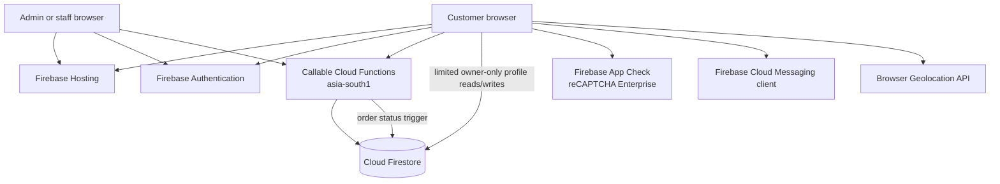

# Craving Heaven Website — Development and Infrastructure Guide

**Prepared:** 6 November 2026
**Repository:** `craving-heaven` (`main`)  
**Firebase project configured by this checkout:** `craving-heaven-e2e94`  
**Firebase Hosting site configured by this checkout:** `craving-heaven-e2e94`

This document describes what is present in this repository. It does not include secrets, customer data, service-account credentials, or a copy of live billing records. This guide is stored under `docs/` and excluded from Firebase Hosting so internal implementation details are not published with the customer site.

## Living-document maintenance

This is the project's canonical development and infrastructure guide. Update it in the same change when website work changes hosting/deployment, Firebase products, data collections or rules, authentication, API integrations, payment/push/location behavior, Function endpoints, or operational costs. Refresh the “Prepared” date and re-check any pricing or live-service statements that may have changed. Keep verified repository facts separate from details that require Firebase/Google Cloud Console confirmation. Never add credentials, OTPs, private keys, or customer data. Keep the `docs/**` Hosting exclusion in `firebase.json` so the internal guide stays out of the public site.

## 1. At a glance

| Area | Current implementation |
|---|---|
| Customer site | Static HTML, CSS, and browser JavaScript; single-page customer experience in `index.html` |
| Admin and staff | Separate pages and browser modules: `admin.html`/`admin.js`, `staff.html`/`staff.js` |
| Hosting | Firebase Hosting; `firebase.json` publishes the repository root except ignored paths |
| Backend | Firebase Cloud Functions, second-generation callable functions and a Firestore document trigger |
| Backend region | `asia-south1` (Mumbai) |
| Runtime | Node.js 22; `firebase-admin` and `firebase-functions` dependencies are in `functions/package.json` |
| Main database | Cloud Firestore, accessed by the Admin SDK in Functions; the customer Firestore Web SDK loads only when saving push-notification tokens |
| Customer sign-in | Firebase Authentication phone OTP; browser local persistence |
| Team sign-in | Firebase Authentication email/password with server-checked `admin`/`staff` custom claims |
| App integrity | Firebase App Check initialized in the browser with the reCAPTCHA Enterprise provider |
| Search discovery | `robots.txt` points to `sitemap.xml`; sitemap lists the canonical customer homepage; admin/staff pages are disallowed for crawlers |
| Front-end performance | Customer Firebase Auth uses local persistence without the unused popup/redirect resolver; Firestore and Messaging load on demand; branded variable fonts are self-hosted; static assets use a seven-day browser/CDN cache |
| Analytics | Google tag (`gtag.js`) in `index.html`; measurement IDs in the HTML and Firebase config differ and should be checked |
| Push | Firebase Cloud Messaging client setup, token registration, and a service worker; no server-side push sender was found in this repository |
| Maps and payments | No Google Maps/Places/Geocoding SDK or online payment gateway is called by the current website code |

The deployed website and source repository are distinct: Firebase Hosting serves the site, while GitHub `main` stores the source. The configured Firebase project is `craving-heaven-e2e94`; do not select the similarly named `craving-heaven-website` project when deploying this checkout.

## 2. System layout



**Customer order flow:** the browser builds the cart and asks the `createOrder` callable to create the order. The server checks the authenticated customer, order availability/test mode, active catalog and reward rules, prices/quantities, delivery rules, points, and reward eligibility before writing. Website test orders are stored separately from live customer orders. The `onOrderStatusChanged` trigger updates loyalty records after relevant order status transitions.

**Store hours display:** the customer home and cart show the live opening schedule returned by `getOrderingStatus`. Default hours are 16:30–23:45 Asia/Kolkata (4:30 PM–11:45 PM); saved Admin hours take precedence. When the schedule is closed, the page also shows the next scheduled opening time without a duplicate closed-hours banner.

**Admin flow:** `admin.html` signs in with email/password. Callable Functions verify the Firebase Auth token and custom admin claim before reading or saving business configuration, managing access, customers, test mode, rewards, or reporting.

**Staff flow:** `staff.html` signs in with email/password. Callable Functions verify the staff/admin claim before staff order lookup, status updates, payment marking, and walk-in order creation.

## 3. Project structure and important files

| File or folder | Purpose |
|---|---|
| `index.html` | Customer home, menu, cart, checkout, account, order history, and rewards page markup; also loads Google tag and FCM client setup |
| `style.css` | Shared customer presentation and responsive layouts |
| `script.js` | Customer interactions, Firebase account flow, cart, checkout, address selection, order/reward display, and notification opt-in |
| `menu.js` | Initial menu and combo catalog data exposed to the customer page and staff tools |
| `rewards-config.js` | Local fallback/default reward configuration; live configuration is also fetched from Functions |
| `craving-dash.js` | Customer game and reward interactions through callable Functions |
| `firebase-client.js` | Firebase Web SDK initialization, App Check, Auth, Firestore, Functions, persistence, and local emulator connections |
| `admin.html`, `admin.js` | Admin sign-in, analytics, settings, menu/reward lineup, access, customer and test-mode management |
| `staff.html`, `staff.js` | Staff sign-in, order queue, status actions, walk-in sales, customer lookup, and online ordering controls |
| `team-account-setup.html`, `team-account-setup.js` | One-time team email/password account setup and account linking |
| `firebase-messaging-sw.js` | Service worker that displays FCM background messages and handles notification clicks |
| `functions/index.js` | Server-side authorization, order processing, config management, loyalty, test mode, and admin/staff callables |
| `functions/rewards-config.js` | Server-side defaults and validation for the reward program |
| `functions/menu-catalog.js` | Server-side menu catalog used to validate authoritative order pricing |
| `functions/scripts/build-menu-catalog.js` | Build step run before Functions deployment |
| `firestore.rules` | Firestore client access rules; default deny applies outside explicitly allowed paths |
| `firestore.indexes.json` | Required Firestore composite indexes |
| `firebase.json` | Hosting, Functions, Firestore, headers, rewrites, and emulator configuration |
| `.firebaserc` | Default Firebase project alias: `craving-heaven-e2e94` |
| `docs/` | Internal development documentation; ignored by Firebase Hosting |

There is no root `package.json`/bundler build. Browser code imports Firebase Web SDK 12.18.0 from `www.gstatic.com`; server code is CommonJS in `functions/` and uses Node.js 22.

## 4. Firebase, Google, and browser services

| Service or API | Evidence in this codebase | What it does | Pricing notes |
|---|---|---|---|
| Firebase Hosting | `firebase.json` | Serves static site files, TLS, CDN, and rewrite `/` to `index.html` | No-cost usage quota, then transfer/storage charges; see cost section |
| Firebase Authentication | `firebase-client.js`, customer `script.js`, `admin.js`, `staff.js` | Customer phone OTP; team email/password; persistent customer session; custom-token/team setup flows | Phone authentication is billed per SMS sent. Email/password is not an SMS charge. |
| Cloud Firestore Standard | `firestore.rules`, `firestore.indexes.json`, `functions/index.js` | Stores profiles, orders, loyalty, restaurant configuration, audit records, game progress, and push tokens | Reads, writes, deletes, storage and network are usage-priced after quotas |
| Cloud Functions for Firebase (2nd gen) | `functions/index.js`, `firebase.json` | Secure callable business logic and the order-status trigger | Invocation, CPU, memory, network, build, and container storage usage may be billed |
| Cloud Run (under Functions v2) | Functions v2 runtime in `asia-south1` | Google Cloud execution layer for deployed second-generation Functions | Billed based on execution/resources; regional CPU quota is a capacity limit, not itself a fee |
| Firebase App Check + reCAPTCHA Enterprise | `firebase-client.js` | Web app attestation/token validation for Firebase services | App Check is no-cost as a Firebase product; Enterprise assessments above their included tier may be billable |
| Firebase Cloud Messaging (FCM) | `index.html`, `script.js`, `firebase-messaging-sw.js`, `functions/index.js` | Customers can opt in to browser notifications; Admin Desk can send an immediate offer/reward message to all registered browser tokens; the service worker displays background notifications | Firebase lists FCM as no-cost. Function invocation, Firestore token reads, and network usage can still have separate costs. |
| Google Analytics 4 tag | `index.html` | Sends browser analytics through `gtag.js` | Firebase lists Analytics as no-cost for standard product use |
| DM Sans and Montserrat font files | `assets/fonts/`, `style.css`, `index.html` | Self-hosted variable fonts; preloaded by the homepage | No Google Fonts network request or Google Maps Platform API is involved |
| Browser Geolocation API | `navigator.geolocation` in `script.js` | Requests GPS coordinates after the customer grants browser permission | This is a browser API, not a Google Geolocation API request; the site does not call the Google Geolocation endpoint |

### APIs not used by the current site code

- **Google Fonts network service:** no hosted Google Fonts CSS/font requests remain; DM Sans and Montserrat are served from the site's own `assets/fonts/` directory.
- **Google Maps JavaScript API, Places API, Geocoding API, Distance Matrix/Routes APIs:** no SDK/script/API calls were found. Address entry is manual; the GPS button saves device coordinates after permission. No reverse-geocoding service converts coordinates to a street address.
- **Google Geolocation API:** not called. It is a separate billable Google web service; `navigator.geolocation` is the browser’s device-location API.
- **Online payment API (Razorpay, Stripe, PayU, Google Pay/UPI API):** none found. Checkout currently records pay-on-delivery or pay-on-pickup options; it does not charge a card or process an online UPI payment.
- **Firebase Storage API:** a storage bucket name is present in client configuration, but no Storage SDK is imported and no upload/download code was found. The bucket may still exist or contain objects; check the Firebase Storage console before assuming its bill is zero.
- **Firebase Analytics SDK:** the site loads the Google `gtag.js` tag directly; it does not import `firebase/analytics`.

### Integration checks identified

1. The Google tag in `index.html` uses measurement ID `G-GD2EPLFYZP`, while the `measurementId` in `firebase-client.js` and `firebase-messaging-sw.js` is `G-GD2EPFLYPZ`. These values differ. Confirm the intended GA4 property/stream and update the incorrect ID if they are meant to be the same. The actual billing/analytics property cannot be confirmed from source alone.
2. Push notifications require customer consent. The website shows an optional prompt, saves an FCM token in `notificationTokens/{token}`, and the Admin Desk has a manual send action backed by `adminSendOfferNotification`. It broadcasts immediately to all subscribed browser tokens; there is no schedule, customer segmentation, or automatic reward-triggered campaign. Only select an offer that is currently available and accurate before sending.
3. This code confirms Functions are in `asia-south1`; it does **not** prove Firestore is in that location. Firestore database location could not be retrieved during this documentation pass. Check Firebase Console → Firestore Database → data/location before making data-residency or regional-price assumptions.

## 5. Authentication and security model

- **Customers:** Firebase phone-number OTP with reCAPTCHA verification. `firebase-client.js` sets `browserLocalPersistence`, so the customer session can survive reloads/browser restarts subject to browser storage and user sign-out.
- **Team:** email/password sign-in. Server code checks custom claims (`admin: true` / `staff: true`) and disabled status. Team accounts are distinct from customer phone-auth sessions.
- **Customer access:** server functions reject disabled, blocked, deleted, and team-as-customer sessions where applicable.
- **Firestore client rules:** customers can read their own profile, eligible own orders/test orders and loyalty data. Customer profile writes are constrained to allowed fields. Orders, loyalty mutations, and privileged changes are server-owned. Unmatched Firestore paths default to deny.
- **Authoritative checkout:** order pricing and reward rules are rechecked on the server; do not treat browser-calculated prices as authoritative.
- **Secrets:** do not add private service-account JSON, Firebase CLI auth codes, OTPs, passwords, FCM server credentials, or customer records to Git or this guide. Browser Firebase config and web attestation keys are client identifiers, not service-account credentials; restrict API keys by allowed APIs/domains where appropriate.
- **App Check:** client initialization uses the reCAPTCHA Enterprise provider. In `functions/index.js`, explicit `enforceAppCheck` options appear on selected Craving Dash callables; do not assume every callable enforces App Check. Verify per-product enforcement in Firebase Console.

## 6. Database model

Firestore is the primary application database. The following collections/subcollections are referenced in code; some are internal/audit/system records.

| Collection | Purpose |
|---|---|
| `customerProfiles/{uid}` | Customer display name and saved delivery addresses |
| `orders/{orderId}` | Live customer and walk-in order records |
| `testOrders/{orderId}` | Separate test-mode orders |
| `loyaltyAccounts/{uid}` | Points, completed-order count, reward tickets, and account-level loyalty state |
| `loyaltyAccounts/{uid}/entries/{entryId}` | Loyalty point/reward ledger entries |
| `restaurantSettings/onlineOrdering` | Ordering open/paused state, test-mode configuration, and operating settings |
| `restaurantSettings/menuCatalog` | Admin-managed live menu/combos |
| `restaurantSettings/rewardsConfig` | Admin-managed reward milestones and reward rules |
| `restaurantSettings/cravingDash` | Game-reward campaign configuration |
| `orderCounters/{counterId}` | Daily order-number counters |
| `orderRequests/{requestId}` | Idempotency/request records for live and staff order creation |
| `testOrderRequests/{requestId}` | Idempotency/request records for test orders |
| `customerBlocks/{uid}` | Customer online-order/account block records |
| `adminAccessChanges`, `adminCustomerBlockChanges`, `adminCustomerAccessRestorations`, `adminCustomerDeletionAudits`, `adminAdjustments`, `adminAuditLogs` | Restricted administrative audit trails |
| `cravingDashAccounts/{uid}` | Customer game progress |
| `cravingDashAccounts/{uid}/challenges/{challengeId}` | Game challenge state |
| `cravingDashChallenges`, `gameRewardAudits` | Challenge/audit records for game reward issuance |
| `notificationTokens/{token}` | Browser FCM registration token and minimal client metadata |

The functions may query other paths indirectly or add fields over time. Treat `functions/index.js` and `firestore.rules` as the source of truth before writing migration scripts.

## 7. Callable and event-driven backend

Current exported callable Functions in `functions/index.js` include:

| Area | Function names |
|---|---|
| Public/customer account and storefront | `getOrderingStatus`, `getPublicBusinessConfig`, `getCustomerAccount`, `saveCustomerProfile`, `createOrder` |
| Online order control / test mode | `adminGetOrderTestMode`, `adminUpdateOrderTestMode`, `staffSetOnlineOrderingEnabled`, `staffSetOnlineOrderingPaused` |
| Admin settings and catalogs | `adminUpdateRestaurantSettings`, `adminGetBusinessConfig`, `adminSaveMenuCatalog`, `adminSaveRewardsConfig`, `adminSaveCravingDashConfig`, `adminSetCravingDashLive`, `adminSendOfferNotification` |
| Admin access and customers | `adminListAccessUsers`, `adminSetUserRole`, `adminTransferSoleAdmin`, `finishTeamEmailSetup`, `adminListCustomers`, `adminGetCustomerDetails`, `adminSetCustomerBlocked`, `adminRestoreTeamCustomerAccess`, `adminDeleteCustomerAccount`, `adminAdjustCustomerBenefits`, `adminGetSalesAnalytics` |
| Staff operations | `staffListOrders`, `staffGetTodaySales`, `staffLookupCustomer`, `staffUpdateOrderStatus`, `staffMarkOrderPaid`, `staffAddItemsToWalkInOrder`, `createWalkInOrder` |
| Craving Dash game | `getCravingDashState`, `startCravingDashStage`, `adminStartCravingDashTest`, `recordCravingDashAction`, `submitCravingDashStage` |

Firestore trigger: `onOrderStatusChanged` reacts to order document updates and updates customer loyalty/points/rewards according to the status and configured rules.

`localDemoCustomerSession` exists only under the local emulator guard; it is not intended to be exported to production.

## 8. Hosting and deployment

`firebase.json` currently configures:

- Hosting site `craving-heaven-e2e94`, with `public: "."` and root rewrite to `index.html`.
- Security headers: HSTS, `nosniff`, same-origin framing, referrer policy, and a permissions policy that disables camera/microphone and sets geolocation policy.
- `index.html`/root no-cache headers; versioned JS/CSS, images, and fonts receive a seven-day public cache lifetime.
- Ignore rules for Functions, rules/index files, hidden files, dependencies, and `docs/**`.
- Functions source folder `functions`, Node.js 22 runtime, and a predeploy menu-catalog build step.
- Local Auth/Firestore/Functions/Hosting emulators on ports 9400/9401/9402/9403.

Common commands from the repository root:

```powershell
firebase use
firebase deploy --only hosting --project craving-heaven-e2e94
firebase deploy --only functions --project craving-heaven-e2e94
firebase deploy --only firestore:rules,firestore:indexes --project craving-heaven-e2e94
```

Only deploy functions/rules/indexes when the relevant code or configuration changed. A Hosting-only UI change does not require a Functions deployment. Always confirm the selected project before deployment; `firebase.json` and `.firebaserc` are configured for `craving-heaven-e2e94`.

Local emulator start command is `start-local-emulators.cmd`. Avoid using real customer accounts or live order data for development. The local demo OTP-free session is guarded to the emulator project.

## 9. Cost guide (official rates checked 3 November 2026)

These are published rates/allowances, not the project's actual bill. Costs depend on the linked Billing account, database location, monthly usage, applicable currency conversion, and taxes. No billing export was available during this documentation pass, so an exact monthly total cannot be stated.

| Service | Current published no-cost allowance / rate relevant to this site | What can create a charge |
|---|---|---|
| Firebase Hosting | 10 GB stored Hosting content and 10 GiB/month data transfer are no-cost; after that, about **$0.026/GB storage** and **$0.15/GB transfer** on Blaze | Large images, repeated downloads, old retained deploy versions, high visits |
| Firestore Standard | One default database: **1 GiB stored**, **50,000 document reads/day**, **20,000 writes/day**, **20,000 deletes/day**, **10 GiB/month egress** no-cost | Customer/admin reads, order writes, audit/loyalty writes, indexes/storage, egress; then location-specific rates. The published table lists approximately **$0.03/100K reads, $0.09/100K writes, $0.01/100K deletes** beyond quota; confirm the database location and calculator result |
| Firebase Auth phone OTP | India listed at **$0.07 per SMS sent**; Identity Platform's current table says first 10 SMS/day are not billed | Each verification SMS sent, including retries/abuse. OTP cost is separate from browser sign-in attempts that send no SMS |
| Firebase Auth email/password | No per-SMS charge; standard email/password team authentication is covered under Firebase Authentication usage limits | Email delivery quotas and abuse/rate-limit controls; do not add the 50K Identity Platform MAU allowance unless the project actually uses that billing product |
| Cloud Functions / Cloud Run | Cloud Functions allowance: **2M invocations/month**, **400K GB-seconds/month**, **200K CPU-seconds/month**, **5 GB outbound network/month**; then invocation is **$0.40/million** and compute/network use Cloud/region rates | Callable execution time, memory/CPU, outbound traffic; Cloud Build and Artifact Registry can apply during deployment |
| Cloud Build / Artifact Registry | **120 build minutes/day** and **500 MB container storage** no-cost; beyond, Firebase pricing currently lists **$0.003/build minute** and Google Cloud container pricing | Repeated/large Function deployments and retained container images |
| Cloud Logging | First **50 GiB/project/month** of log ingestion is free; after that **$0.50/GiB**; extended retention can cost extra | Verbose function logs, sensitive values accidentally logged, retention beyond default |
| reCAPTCHA Enterprise / App Check | Firebase App Check is no-cost; web App Check uses an assessment when tokens refresh. reCAPTCHA Essentials has up to **10,000 assessments/month free**. The Premium tier lists **$8 flat for 10,001–100,000**, then **$1/1,000 above 100,000** | App Check token refreshes and other assessments; the actual key's billing tier and usage must be checked in Google Cloud Fraud Defense |
| Firebase Cloud Messaging | No-cost | No FCM message fee listed; other services used to produce/schedule campaigns can have their own costs |
| Google Analytics | Firebase lists Analytics as no-cost | Separate advertising products, exports, or third-party integrations are not included |
| Google Maps Platform | **No usage found in this codebase** | No Maps, Places, Geocoding, Routes, or Google Geolocation API charge should come from current site code. Enabling/calling one later requires separate usage and billing review |
| Cloud Storage for Firebase | Bucket is configured but Storage SDK calls were not found | Existing objects, if any, and future file uploads/downloads/operations. Check Storage console before concluding actual cost is zero |

**Cloud Run quota vs charge:** a CPU allocation quota being full can block Function deployment/scaling even when current invoice is low. Raising a quota normally changes capacity, not the per-use price. Actual charges come from executed compute, storage, requests, builds, logging, and egress.

**Cost control:** budget alerts notify but do not automatically stop usage. Review Google Cloud Billing → Reports by product and Firebase Console → Usage; set low budget alerts; restrict OTP SMS to India if the customer base is India-only; monitor sent vs verified SMS; limit log volume; periodically delete old Hosting versions/unused Artifact Registry images. Confirm actual monthly rates and taxes on the linked Billing account.

## 10. Known operational checks and unresolved items

- **PageSpeed mobile baseline (5 November 2026, 12:47 PM):** Lighthouse score 50, FCP 1.5 s, LCP 5.0 s, TBT 310 ms, CLS 0.54; Accessibility 96, Best Practices 96, SEO 100. The report showed no field data.
- **Optimization work (5 November 2026):** self-hosted the existing DM Sans/Montserrat fonts, optimized the combo/logo assets, deferred Firestore/Messaging and App Check until needed, reserved homepage combo space, and added a seven-day cache for static assets. App Check remains enabled for the protected Craving Dash functions and admin game actions. No customer order, account, or loyalty APIs are exempted by this change; only game functions enforce App Check in `functions/index.js`.
- **Post-deploy mobile PSI variability:** repeated Lighthouse runs used Moto G Power emulation, slow 4G, Lighthouse 13.6.0 and reported no field data. After deferring App Check, one run scored **86** (FCP 0.9 s, LCP 3.7 s, TBT 40 ms, CLS 0.103; Accessibility/Best Practices/SEO 100). After image resizing, a run scored **69** (FCP 2.8 s, LCP 4.6 s, TBT 230 ms, CLS 0.078), followed by **74** (FCP 2.8 s, LCP 4.5 s, TBT 60 ms, CLS 0.078; Accessibility/Best Practices/SEO 100). These scores vary between runs; use repeated runs and real-user field data when available. Latest report (5 November 2026, 1:22 PM): https://pagespeed.web.dev/analysis/https-cravingheaven-com/0pjn16yfam?form_factor=mobile .
- **Latest report's remaining Lighthouse opportunities:** render-blocking `style.css` (estimated 150 ms), about 16 KiB of image savings, unused JavaScript (~107 KiB), and minor CSS/JS minification opportunities. Keep the main stylesheet render-blocking unless a critical-CSS split is visually/regression tested; unstyled early paint could worsen layout shift and customer experience. Best Practices is now 100, with no homepage App Check/reCAPTCHA console error.

1. **Firestore location:** not confirmed from this repository. Functions use Mumbai (`asia-south1`), but the Firestore database may be in another region. Verify before estimating regional pricing or latency.
2. **GA4 IDs:** HTML gtag and Firebase config measurement IDs differ; verify intended stream.
3. **Push notifications:** customer token opt-in and background display exist, but no server sender/campaign function was found.
4. **Maps/geocoding:** no provider is connected. GPS returns coordinates only; no automatic human-readable address is produced by this code.
5. **Payments:** no online payment gateway integration was found. Payment setup should be treated as pay-on-delivery/pickup until a gateway is deliberately added and tested.
6. **Billing total:** not included; retrieve Billing Reports and usage metrics to produce a true last-month/forecast total.
7. **Custom domain mapping:** the code references `cravingheaven.com` and Hosting site ID is `craving-heaven-e2e94`; domain DNS/custom-domain attachment was not revalidated as part of this documentation pass.
8. **Cloud Run CPU capacity:** an earlier user-provided console screenshot showed the `asia-south1` Cloud Run CPU allocation quota at 100%. This document does not claim that the quota is still currently full. The Functions code caps global `maxInstances` at 2 and selects `gcf_gen1` CPU to constrain the footprint; that does not eliminate every regional quota or deployment limit.

## 11. Official references

Prices change; use these official pages for the live price and billing model:

- [Firebase pricing](https://firebase.google.com/pricing)
- [Firebase billing plans and Blaze behavior](https://firebase.google.com/docs/projects/billing/firebase-pricing-plans)
- [Firebase Phone Auth for web](https://firebase.google.com/docs/auth/web/phone-auth)
- [Identity Platform phone SMS pricing](https://cloud.google.com/identity-platform/pricing)
- [Cloud Firestore pricing](https://cloud.google.com/firestore/pricing)
- [Firebase Hosting quotas and pricing](https://firebase.google.com/docs/hosting/usage-quotas-pricing)
- [Cloud Run pricing](https://cloud.google.com/run/pricing)
- [reCAPTCHA pricing](https://cloud.google.com/security/products/recaptcha)
- [Firebase App Check with reCAPTCHA Enterprise](https://firebase.google.com/docs/app-check/web/recaptcha-enterprise-provider)
- [Cloud Logging pricing](https://cloud.google.com/products/observability/pricing)
- [Firebase Cloud Messaging documentation](https://firebase.google.com/docs/cloud-messaging)
